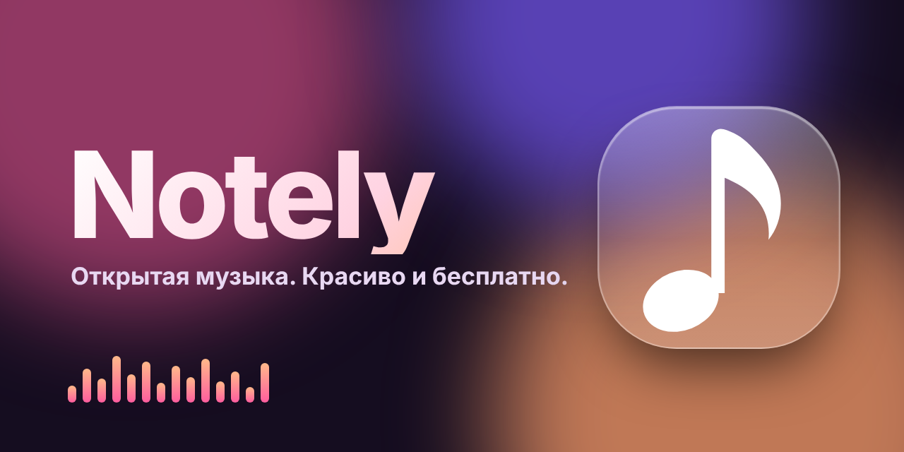
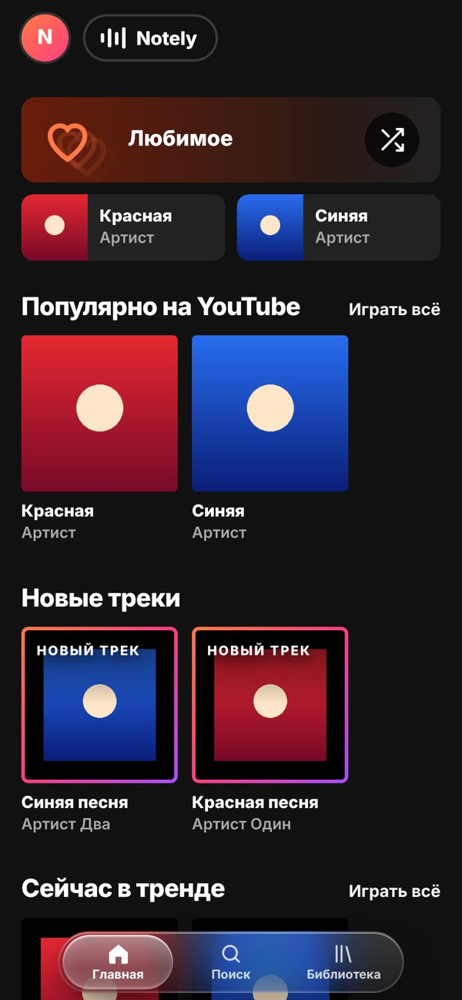
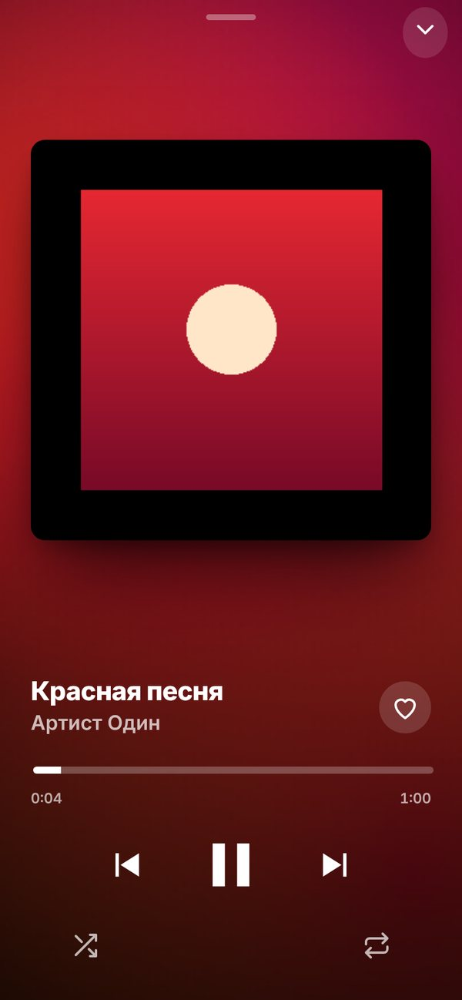
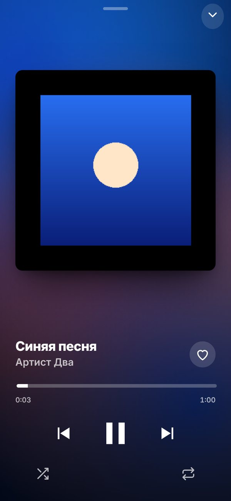
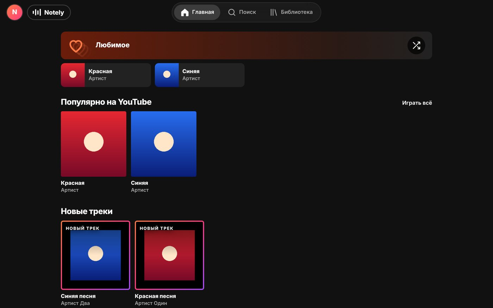
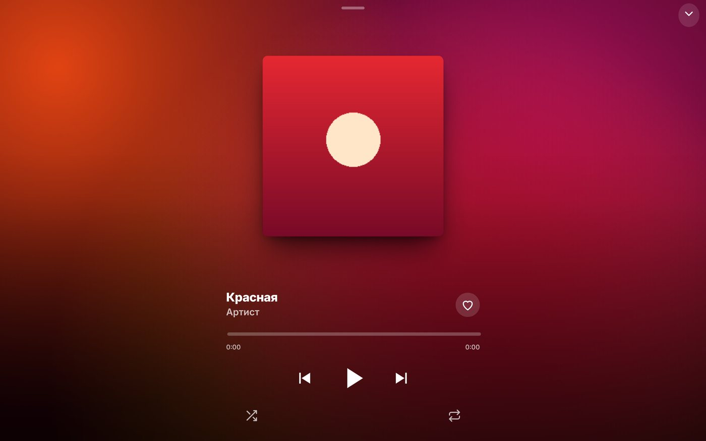

 

**Слушай открытую музыку из каталогов Audius и Jamendo.**
Тёмный плоский дизайн, стеклянные вкладки, живые фоны в полном плеере и обложка с аурой.

 

---

## Что это

**Notely** — музыкальный сайт, который работает как приложение. Находишь песню, нажимаешь, и она играет целиком. Без регистрации, без оплаты, без рекламы.

Музыка берётся из двух открытых каталогов, где артисты сами разрешили слушать свои треки:

| Каталог | Что там | Нужен ключ |
|---|---|---|
| **Audius** | Много независимых артистов, электроника, хип-хоп, лоу-фай | нет |
| **Jamendo** | Десятки тысяч свободных треков | да, бесплатный |
| **YouTube** | Почти любая песня целиком (видео играет в окошке) | да, бесплатный ключ Google |

> Здесь нет Spotify и Apple Music: их музыку нельзя играть в чужом приложении без платной подписки. Подробнее в разделе «Вопросы».

---

## Что умеет

- **Фон под обложку.** В полном плеере за обложкой плавно плывут цветные пятна из цветов самой обложки, как в Apple Music. Когда трек играет, они оживают.
- **Свайпы.** В плеере: влево и вправо меняют трек, вниз закрывает. На мини-плеере: влево и вправо меняют трек, вверх открывает. На страницах: влево и вправо переключают вкладки.
- **Стеклянные вкладки.** Внизу на телефоне капсула в стиле жидкого стекла. Стеклянную «линзу» можно тянуть пальцем между вкладками.
- **Плеер.** Перемотка, громкость, перемешивание, повтор, кнопки на экране блокировки. Полный плеер раскрывается кругом снизу.
- **Любимое.** Сердечко у трека сохраняет его в твой список. Список хранится на твоём устройстве.
- **Поиск** сразу по двум каталогам и подборки по жанрам на главной.
- **Много мелких анимаций:** карточки блестят, сердечко рассыпается мини-сердцами, обложка «дышит» под музыку, длинные названия бегут строкой.
- **Устанавливается.** Можно добавить на главный экран телефона, и откроется как отдельная программа.

---

## Скриншоты

> На картинках тестовые треки, поэтому обложки цветные. В настоящих треках будут настоящие обложки.

---

## Как пользоваться

1. Открой сайт: **https://felykxzy.github.io/notely/**
2. Нажми на любой трек на главной, и он заиграет.
3. Чтобы искать любые песни, вставь бесплатный ключ YouTube в настройках (как получить: Google Cloud → YouTube Data API v3 → создать ключ).
4. Чтобы увидеть треки Jamendo, открой настройки (шестерёнка) и вставь бесплатный ключ:
   1. Зайди на [devportal.jamendo.com](https://devportal.jamendo.com) и создай приложение.
   2. Скопируй `client_id`.
   3. Вставь его в настройки Notely и нажми «Сохранить».
5. На телефоне можно добавить сайт на главный экран, и он откроется на весь экран.

Горячие клавиши на компьютере: **Пробел** — пауза, **Shift + стрелки** — следующий и предыдущий трек, **Esc** — закрыть полный плеер.

---

## Вопросы

**Почему нет Spotify и Apple Music?**
Они не разрешают играть свою музыку в чужих приложениях бесплатно. Для Spotify нужен Premium, для Apple Music нужен платный аккаунт разработчика, а у SoundCloud ключи теперь только по подписке. Мы честно берём только открытые каталоги.

**Почему мало знакомых хитов?**
В Audius и Jamendo в основном независимые артисты, а не мировые звёзды. Зато всё это можно слушать бесплатно и законно.

**Песня не играет.**
Проверь интернет и нажми другой трек. Если не помогает, напиши мне, что именно написано на экране.

---

## Что внутри

Один сайт без сборки и без лишних библиотек: `index.html`, `app.js`, `bg.js` (живые фоны), `sw.js` (работа без сети), `manifest.webmanifest`.
Открытые данные: [Audius](https://docs.audius.org/api) и [Jamendo](https://developer.jamendo.com/v3.0).

## Дальше

- [ ] Список «Недавно слушал»
- [ ] Очередь воспроизведения
- [ ] Свои плейлисты
- [ ] Тексты песен
- [ ] Настоящее приложение для телефона и компьютера

---

Сделано с любовью к музыке 💗

## Чтобы людям не надо было вводить ключи

Владелец сайта один раз заполняет `config.js`:

- `jamendo` — бесплатный `client_id` с [devportal.jamendo.com](https://devportal.jamendo.com);
- `proxy` — адрес посредника для YouTube. Как его сделать, написано в [`proxy/README.md`](proxy/README.md).

После этого поиск полных песен работает у всех без настроек. Свои ключи в настройках остаются необязательными.
